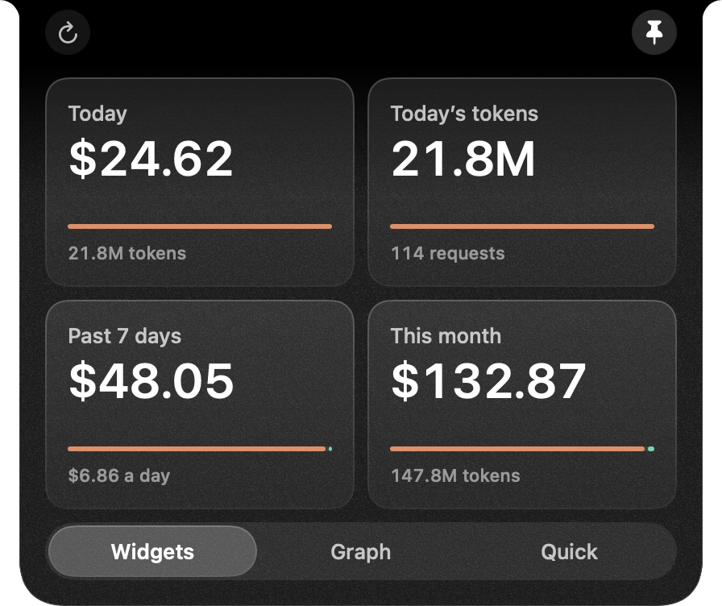
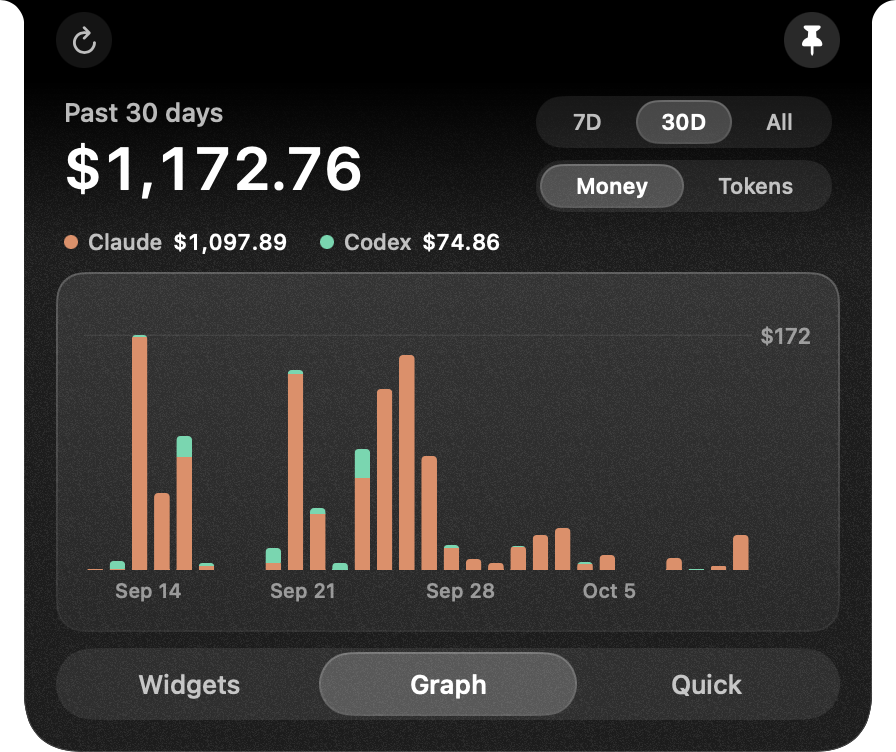
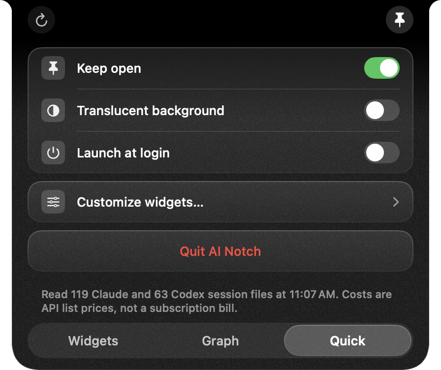

# AI Notch

[](https://github.com/Lucassnam/ai-notch/actions/workflows/ci.yml)
[](LICENSE)

**See what your AI coding actually uses, right beside the MacBook notch.**

A flat plan has no meter. You pay the same whether you sent ten requests or ten
thousand, so there is nothing to tell you how much you are leaning on it. AI
Notch puts the meter back: it reads the usage logs that Claude Code and Codex
already write on your Mac and shows your tokens, and what those tokens would
cost at public API prices, in the menu bar.

<p align="center">
  <br>
  <sub>Closed. The black middle is where the notch sits.</sub>
</p>

<p align="center">
  
</p>

## Why bother on a subscription

The Mac these screenshots came from ran up **$1,172.76 of usage in 30 days**,
priced at API list rates across Claude Code and Codex. That is not a bill. It
is the size of the thing a subscription is quietly absorbing, and you cannot
see it anywhere else.

Knowing the number changes a few things:

- **You notice the expensive habits.** A long session that keeps re-reading a
  huge context costs far more per request than a short one. The five-hour and
  today figures move while you work, so you see it happen.
- **You can judge a plan change with your own data.** Whether an upgrade, a
  downgrade or a move to pay-as-you-go makes sense depends on what you really
  use. The 7-day, 30-day and monthly views are that answer.
- **You see a limit coming.** Where the CLI reports a rate-limit window, the
  notch shows how much is left.

<p align="center">
  
</p>

## What it shows

Two values sit beside the notch at all times. Hover to open the panel:

| Tab | What is on it |
|---|---|
| **Widgets** | A grid of the metrics you choose. Each card has the figure, what it is made of, and a bar showing the provider split or how much of a limit is left. |
| **Graph** | Daily spend or tokens for 7 days, 30 days, or everything on disk, stacked by provider. |
| **Quick** | Keep open, translucent background, launch at login, customize, quit. |

There are 12 metrics to pick from, for the grid and for the two notch slots:
today's spend, last five hours' spend, five-hour tokens, today's tokens, past 7
days, this month, and per-provider versions (Claude today, Codex today, Claude
five-hour tokens, Codex five-hour tokens, Claude limit, Codex limit).

<p align="center">
  
</p>

## Private by construction

- It reads two folders: `~/.claude/projects/` and `~/.codex/sessions/`.
- From those files it keeps token counts, model names, timestamps and the
  name of the project folder. Your prompts and the replies are in the same
  files; the app never stores or displays them.
- It makes no network requests. There is no networking code in the app, no
  account to sign in to and no API key to paste.
- It writes two files of its own, both in
  `~/Library/Application Support/AINotch/`: a parse cache and a usage history.

## What it does not do

Worth knowing before you install it:

- **It only sees the command-line tools.** Claude Code and Codex write local
  logs. The Claude and ChatGPT apps and websites do not, so chats there never
  show up.
- **The dollar figure is an estimate, not your bill.** It is your token mix
  multiplied by public API list prices. The price table lives in
  [`PricingCatalog.swift`](Sources/AINotch/Services/PricingCatalog.swift) and
  was last checked on 2026-08-11. A model released after that is priced as the
  nearest model in its family.
- **Claude's subscription quota is not available.** Claude Code does not write
  a quota percentage to its logs, so the Claude limit card stays empty unless a
  rate-limit record appears. Codex does report one.
- **A limit can be stale.** The limit card shows the newest record in the logs.
  If that window has already ended it says "Reset due" under the figure.
- **History starts where your logs do.** Claude Code deletes transcripts after
  30 days by default (`cleanupPeriodDays` in `~/.claude/settings.json`). AI
  Notch keeps its own history from the day you first run it, but it cannot
  recover what was deleted before then. The widest graph range is labelled
  "Since" with a date for that reason, never "All time".

## Counting once

A Claude transcript writes one row per content block and rewrites rows while a
reply streams, so one API request appears several times with the same usage
attached. AI Notch groups rows by request ID and counts each request once. On
the machine it was developed on, that turned 12,341 usage rows into 5,713
requests. Adding up every row would have reported 2.05 times the real figure,
which is why a tool that shows a much larger total is probably summing rows.

## Install

There is no download yet, so you build it. You need a Mac on macOS 14 or
later and Xcode 26 (the code references macOS 26 APIs behind availability
checks, so an older SDK will not compile it).

```sh
git clone https://github.com/Lucassnam/ai-notch.git
cd ai-notch
./scripts/build-app.sh
open "dist/AI Notch.app"
```

The app has no Dock icon. It lives beside the notch and as a waveform icon in
the menu bar. On a Mac without a notch it sits at the top centre of the screen.

The build is signed ad hoc, not notarized. If you copy the app to another Mac,
macOS will block the first launch until you allow it under System Settings,
Privacy & Security, Open Anyway.

To have it start with your Mac, turn on **Launch at login** on the Quick tab.

## Development

```sh
swift build
swift test          # 53 tests
swift run AINotch   # runs without building the bundle
```

`swift run` uses a different preferences domain (`AINotch`) from the app bundle
(`com.local.ainotch`), so the two keep separate layouts.

### Screenshots that tell the truth

A screenshot never contains the hardware notch. The display has no pixels
there, so a capture shows the panel as one unbroken strip and a value hidden
behind the notch looks correctly placed. Set `AINOTCH_SHOW_NOTCH=1` and the app
paints a marker where it measured the notch:

```sh
AINOTCH_SHOW_NOTCH=1 ./scripts/snapshot.sh dist/snapshots
```

The script builds the bundle and captures the collapsed bar, each tab, each
graph range and the Customize window. While it runs the panel ignores the
pointer, so using the Mac cannot change what is captured.

The notch is not one size. A 14-inch MacBook Pro reports 185 × 32pt at default
scaling and 220 × 38pt at "More Space". Add `AINOTCH_FAKE_NOTCH_WIDTH` and
`AINOTCH_FAKE_NOTCH_HEIGHT` to check the mode you are not in, or to work on a
display with no notch at all.

### Layout rules

The opened panel runs on two numbers: 16pt from every painted edge and 8pt
between neighbours. The panel body is narrower than its frame by one shoulder
per side, so use `NotchMetrics.outerPadding` and never a flat padding value.
`NotchLayoutTests` guards both.

### Alongside Boring Notch

AI Notch runs as its own overlay a couple of window levels above Boring Notch,
so both can be installed. Quitting AI Notch hands the notch back.

## License

[MIT](LICENSE)
